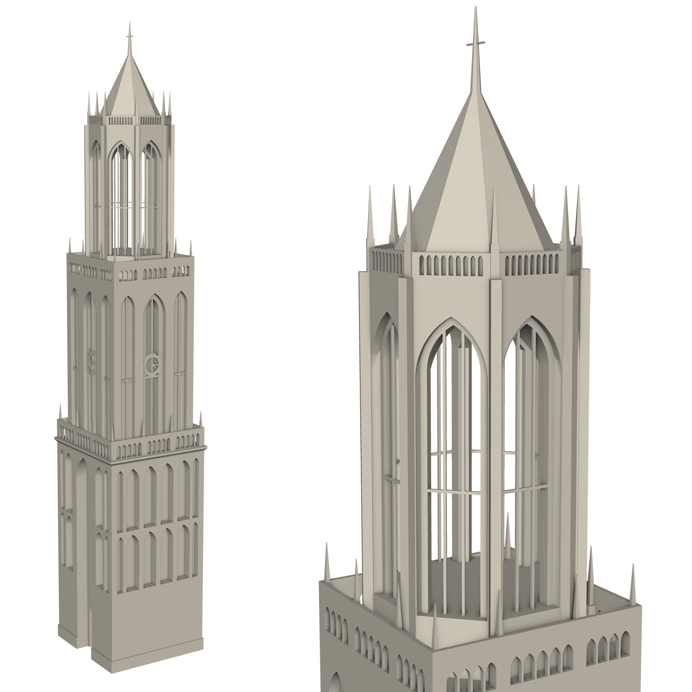
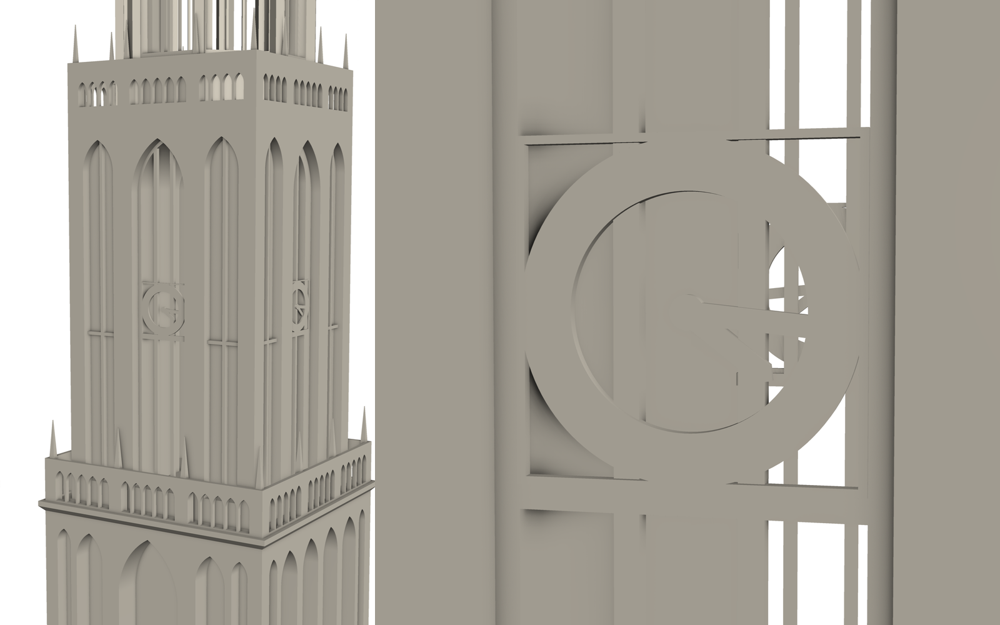

# Dom Tower, Utrecht: parametric 3D model



*Render of the 1:100 model (variant K): the whole tower, and a close-up of the octagonal lantern with the spire.*

A parametric model of the Dom Tower (Domtoren) in Utrecht, the Netherlands. At 112.32 m it is the tallest church
tower in the country. A Python script builds the model from scratch in FreeCAD 1.0, at true size (1 unit = 1 mm of
the real tower). The scale is applied only on export. Explicit rules handle details that are too small to print at the
chosen scale: they are thickened, turned into a niche, or left out. The output states which rule was applied to each
part.

Every dimension in the model comes from a documented source: a publication, a measured drawing from 1899 that is now
in the public domain, or open government data. The sources and their licences are listed below.

### The clock



The tower has four clock faces, one in each belfry opening of the second stage. Each is about 4 m across, and sits in
a square frame on the transom of the opening. The model shows them at true scale at 1:100, with the hands at 16 minutes
past 4 by default. The clock can be switched off, and the time can be changed (see *Building the model yourself*).

## Download

| File | Scale | Size (mm) | What it is |
|---|---|---|---|
| [`models/dom-tower-1-1000-print.stl`](models/dom-tower-1-1000-print.stl) | 1:1000 | 21.1 × 21.1 × 112.3 | **Print this one.** Hollow (4 mm wall), print-tested, without the clock. |
| [`models/dom-tower-1-1000.step`](models/dom-tower-1-1000.step) | 1:1000 | 21.1 × 21.1 × 112.3 | Solid, with the clock. |
| [`models/dom-tower-1-300.step`](models/dom-tower-1-300.step) | 1:300 | 67 × 67 × 374.4 | Solid, with the clock. |
| [`models/dom-tower-1-100.step`](models/dom-tower-1-100.step) | 1:100 | 201 × 201 × 1123.2 | Solid, with the clock; all parts at true scale. For reference and CAD; too tall to print in one piece. |

At 1:1000 a printer cannot reproduce every detail. 90 parts are printed as they are, 62 are thickened to at least
two extrusion widths, 8 openings become niches, and 16 parts that are too small are left out. At 1:100 and 1:300
almost everything is at true scale. At 1:1000 the clock is only 4 mm wide: it becomes a small square plate with a round
hole, and the hands are left out.

## Printing (1:1000)

Tested on a RatRig V-Core 3 (Klipper, 0.4 mm nozzle) sliced with PrusaSlicer:

- layer height 0.2 mm, first layer 0.35 mm, 3 perimeters, 0.45 mm extrusion width
- eSun PLA+
- a 5 mm brim on the outside only: the tower is tall and narrow, and the passage through the base means it stands on
  two legs
- no supports: overhangs are at most 45 degrees, and the passage and the lantern windows bridge cleanly
- about 1 h 50 min, 17 g of filament

The STL has one closed internal cavity, which slicers handle as an internal void.

## Building the model yourself

You need FreeCAD 1.0. Run the build script with `freecadcmd` from the repository folder:

```sh
freecadcmd -c "SCHAAL=1000; VARIANT='A'; exec(open('maak_domtoren.py').read())"
```

On macOS, `freecadcmd` is at `/Applications/FreeCAD.app/Contents/Resources/bin/freecadcmd`.

All settings are optional:

| Setting | Default | Meaning |
|---|---|---|
| `SCHAAL` | `1000` | Scale denominator (tested: 1000, 300, 100). |
| `VARIANT` | `"A"` | Letter used in the file names and in the label. |
| `GELEDING` | all | Build one section only: `onderbouw`, `vierkant_1`, `vierkant_2`, `lantaarn`, `spits` or `bekroning`. |
| `AANDIK` | `2` | Thickening level for small details: 0 = off, 1 = just printable, 2 = clearly visible, 3 = architectural model. |
| `HOL` | `True` | `True` = hollow, with the variant letter engraved in the base; `False` = solid, no label. |
| `LABEL` | `True` | `False` = hollow, but without the label. |
| `KLOK` | `True` | `True` = with the four clock faces; `False` = without the clock. |
| `KLOKTIJD` | `"4:16"` | Time shown by the clock hands, as `"h:mm"`. |
| `FCSTD` | `True` | `False` = do not write the `.FCStd` file (needed while the FreeCAD GUI is running). |

The script writes `Domtoren <variant>.FCStd`, `Domtoren <variant>.step` (true size),
`Export 1-<scale>/Domtoren <variant>.stl` and a report. It checks the STL itself: it must be closed, manifold, and in
one piece (plus one piece for each internal cavity).

Notes:

- The label uses Arial Narrow Bold or Arial Bold from macOS (`/System/Library/Fonts/Supplemental`). On other systems,
  build with `LABEL=False` or `HOL=False`, or change `LETTERTYPES` in `maak_domtoren.py`.
- The script stops with an error if FreeCAD is running and it would overwrite an `.FCStd` file. Close FreeCAD, or use
  `FCSTD=False`.
- Tests: `pytest tests/test_maten.py tests/test_regels.py` (plain Python), and for the model itself
  `freecadcmd -c "exec(open('tests/draai_freecad_tests.py').read())"`.
- `controleer_ahn.py` checks the heights against AHN elevation data and the footprint against the BAG building
  registry: `uv run --no-project --with requests,numpy,rasterio python controleer_ahn.py`.

## Files and language

The code, its comments and the project notes are in Dutch. This README and the files in `models/` are in English.

| File | Contents |
|---|---|
| `maak_domtoren.py` | Build script: builds, exports and checks the model. |
| `maten_domtoren.py` | Every dimension of the tower (true size, mm), each with its source and how certain it is. |
| `domtoren_vormen.py` | The shapes: facades, niches, cornices, balustrades, pinnacles, lantern, spire and finial. |
| `domtoren_regels.py` | The rules: minimum detail size, thickening, openings, hollowing. |
| `controleer_ahn.py` | Check against AHN elevation data and the BAG footprint. |
| `tests/` | Tests. |
| `bronnen.md` | Sources: every dimension with its source and certainty, conflicts between sources, and the full source list. |
| `varianten.md` | What each variant letter (A to J) means. |
| `LEESMIJ.md` | Dutch readme with more detail on how the model is built. |
| `ontwerp.md`, `plan.md`, `plan_kleuren.md` | Design, build plan, and a plan for a coloured version (not done yet). |

A few Dutch words that appear everywhere: *geleding* = stage of the tower, *onderbouw* = base, *vierkant* = square
stage, *lantaarn* = octagonal lantern, *spits* = spire, *bekroning* = finial (orb, cross and weather vane), *nis* =
niche, *galmgat* = belfry opening, *pinakel* = pinnacle, *omgang* = gallery, *doorgang* = passage, *maten* =
dimensions, *bron* = source, *schaal* = scale, *hol* = hollow, *aandikken* = thicken, *klok* = clock, *wijzer* =
clock hand, *wijzerplaat* = clock face.

## Sources

Consulted on 19 November 2026. The full list, with which dimension comes from which source and how certain it is,
is in [`bronnen.md`](bronnen.md) (Dutch).

**Dimensions and shapes**

| Source | Licence | Used for |
|---|---|---|
| E.J. Haslinghuis and C.J.A.C. Peeters, *De Dom van Utrecht*, De Nederlandse Monumenten van Geschiedenis en Kunst, Staatsuitgeverij, The Hague 1965, pp. 413–458. [DBNL](https://www.dbnl.org/tekst/hasl001domv01_01/hasl001domv01_01_0006.php) | Copyright; consulted only | Main dimensions: footprint, stage heights, wall thickness, passage, lantern, galleries, spire. Numbers only; no text or figures. |
| G. de Hoog Hz., elevations of the west facade, first, second and third stage with spire, 1899, scale 1:50 (restoration plan F.J. Nieuwenhuis). Het Utrechts Archief [216776](https://commons.wikimedia.org/wiki/File:HUA-216776-Opstand_van_de_westgevel_van_de_eerste_geleding_en_de_eerste_omgang_van_de_Domtoren_te_Utrecht.jpg), [216777](https://commons.wikimedia.org/wiki/File:HUA-216777-Opstand_van_de_westgevel_van_de_tweede_geleding_en_de_tweede_omgang_van_de_Domtoren_te_Utrecht.jpg), [216778](https://commons.wikimedia.org/wiki/File:HUA-216778-Opstand_van_de_westgevel_van_de_derde_geleding_en_de_derde_omgang_met_spits_van_de_Domtoren_te_Utrecht.jpg) (via Wikimedia Commons) | Public domain | Facade layout: niches, piers, belfry openings, cornices, balustrades, pinnacles, lantern, cross. Measured on the drawings. |
| J. van Maurik, elevation of the north facade, first stage, 1830–1840. Het Utrechts Archief [216377](https://commons.wikimedia.org/wiki/File:HUA-216377-Opstand_van_de_noordgevel_van_de_eerste_geleding_van_de_Domtoren_te_Utrecht_met_vermelding_van_een_aantal_afmetingen.jpg) | Public domain | North facade: buttresses, niches and piers. |
| Unknown maker, cross-section of the Dom Tower, 1901–1902, scale 1:400. Het Utrechts Archief [39897](https://commons.wikimedia.org/wiki/File:HUA-39897-Doorsnede_van_de_Domtoren_te_Utrecht.jpg) | Public domain | Check of heights and openings. |
| Ginelly.Q, [*Domtoren taken from Mariaplaats, Utrecht*](https://commons.wikimedia.org/wiki/File:Domtoren_taken_from_Mariaplaats,_Utrecht.jpg), 2025, Wikimedia Commons | CC0 1.0 | Check after the restoration that ended in 2024: balustrades, pinnacles, lantern width. The shape and size of the clock: frame, dial ring, hands and height. |
| Gemeente Utrecht (Erfgoed Utrecht), [*Domtoren*](https://erfgoed.utrecht.nl/verhalen/domtoren) and [*Het uurwerk van de Domtoren*](https://erfgoed.utrecht.nl/verhalen/domtoren/het-uurwerk-van-de-domtoren) | Copyright; consulted only | Total height 112.32 m and the height of the finial; four clock faces. Numbers only. |
| DUIC, [news item of 8 January 2026](https://www.duic.nl/algemeen/algemeen/58847/wijzer-van-klok-op-domtoren-afgevallen-uurwerk-wordt-gecontro) and [*Domtoren in Utrecht krijgt wijzerplaten terug*](https://www.duic.nl/algemeen/algemeen/54986/fotos-domtoren-in-utrecht-krijgt-wijzerplaten-terug) | Copyright; consulted only | The clock: four faces, one per side, each about 4 m across. Numbers only. |
| Kadaster, BAG (Basisregistratie Adressen en Gebouwen), building 0344100000039864, via [PDOK](https://service.pdok.nl/lv/bag/wfs/v2_0) | CC0 1.0 | Orientation of the facades; check of the footprint. |
| Het Waterschapshuis / Rijkswaterstaat, AHN4 elevation model (DSM and DTM, 0.5 m), via [PDOK](https://service.pdok.nl/rws/ahn/wcs/v1_0) | CC0 1.0 | Height check only. |
| AHN, Het Waterschapshuis: AHN5 DSM 0.5 m (2023), tile 31HZ2, via [GeoTiles](https://geotiles.citg.tudelft.nl/tiles/html/31HZ2.html) (TU Delft) | CC BY 4.0 | Height check only. |

**Background (no dimensions taken)**

| Source | Licence |
|---|---|
| M. Wiegman, "De restauratie van de Domtoren, verschillende restauratieopvattingen verenigd", *Bulletin KNOB* 109 (2010) no. 6, pp. 222–233, [doi:10.7480/knob.109.2010.6.126](https://bulletin.knob.nl/index.php/knob/article/view/233) | CC BY 4.0 |
| Review of R. de Kam, F. Kipp and D. Claessen, *De Utrechtse Domtoren, trots van de stad* (Matrijs 2014), [*Bulletin KNOB* 2015-3](https://bulletin.knob.nl/index.php/knob/article/download/76/76/81) | CC BY 4.0 |
| Wikipedia, [*Dom Tower of Utrecht*](https://en.wikipedia.org/wiki/Dom_Tower_of_Utrecht) | CC BY-SA 4.0 (facts read, nothing copied) |
| J.E.A.L. Struick, "De ruimtelijke voorbereiding op de bouw van de Gothische domtoren te Utrecht", *Maandblad Oud-Utrecht* 55 (1982) no. 6, pp. 131–133, [Utrecht University repository](https://dspace.library.uu.nl/handle/1874/287940) | Copyright; consulted only |

A few dimensions have no direct source. They are derived or estimated from the sources above, and are marked
*geschat* (estimated) in `bronnen.md` and `maten_domtoren.py`. The time on the clock (4:16) is a choice, marked
*keuze*. The drawings and the photo are not included in this
repository; follow the links.

## Licence

The model and everything in this repository is licensed under
**[Creative Commons Attribution-NonCommercial 4.0 International (CC BY-NC 4.0)](https://creativecommons.org/licenses/by-nc/4.0/)**,
© 2026 B. Nelissen. This covers the build script, the dimension tables, the documentation, and the exported files
(FCStd, STEP, STL). The full legal text is in [`LICENSE`](LICENSE). The licence is also written into the files
themselves: the FCStd document properties, the STEP header, and the STL header.

You may share, print and adapt the model, as long as you:

- **give credit**, for example: *"Dom Tower model by B. Nelissen, CC BY-NC 4.0, https://github.com/bglnelissen/domtoren"*;
- **link to the licence** and **say what you changed**;
- **do not use it commercially**. Selling prints or files, or using them in a paid product, needs permission.

### Why this licence can be applied

Anyone who publishes a model of an existing building must make sure that none of its sources restrict how the model
may be licensed. For this model:

- **The geometry is original.** The build script constructs every shape itself. No meshes, CAD files or traced
  outlines from other people's models (Printables, Thingiverse, Google Earth and the like) were used.
- **Dimensions are facts.** Copyright protects text, figures and photographs, not measurements. From the copyrighted
  publications (Haslinghuis and Peeters 1965, Erfgoed Utrecht, DUIC) only numbers were taken. None of their text, figures or
  photos are in this repository.
- **The drawings, the photo and the open data impose no conditions.** The drawings from 1830–1902 are in the public
  domain. The reference photo is CC0, and the BAG and AHN4 data are CC0.
- **The CC BY sources** (AHN5 and the two KNOB articles) were used only as a check or as background. Nothing from them
  is in the model, and they are credited above anyway.
- **No share-alike material was used.** Photos and text under CC BY-SA (such as Wikipedia) did not contribute any
  geometry, so the model does not have to be released under CC BY-SA.
- **The building itself is free to depict.** The Dom Tower is a medieval building, completed in 1382. Its design is
  not protected by copyright.

So the author is free to choose a licence for the model, and has chosen CC BY-NC 4.0. The sources keep their own
licences: the public-domain drawings stay public domain, and nothing here places them under CC BY-NC.
